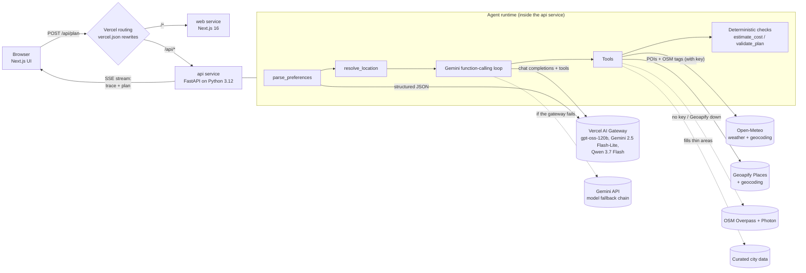
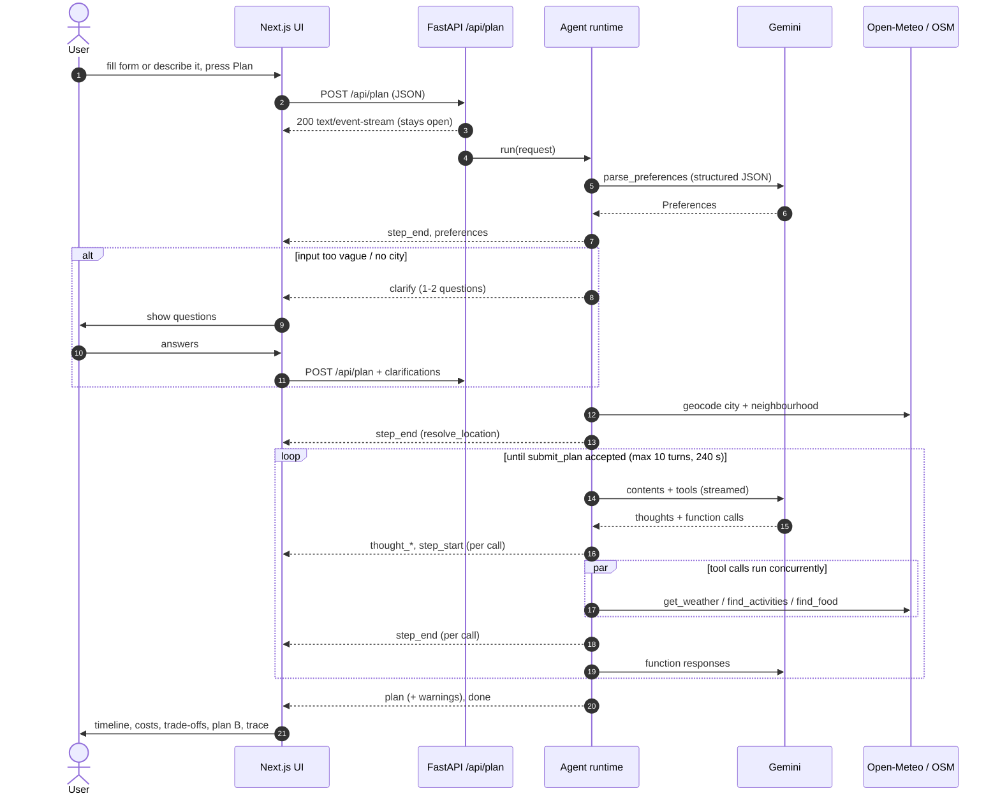
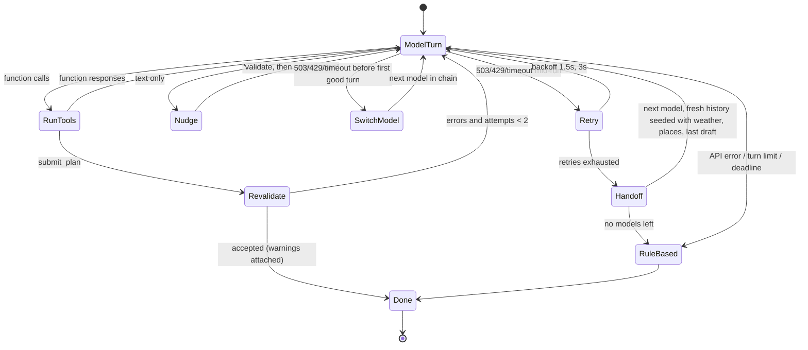
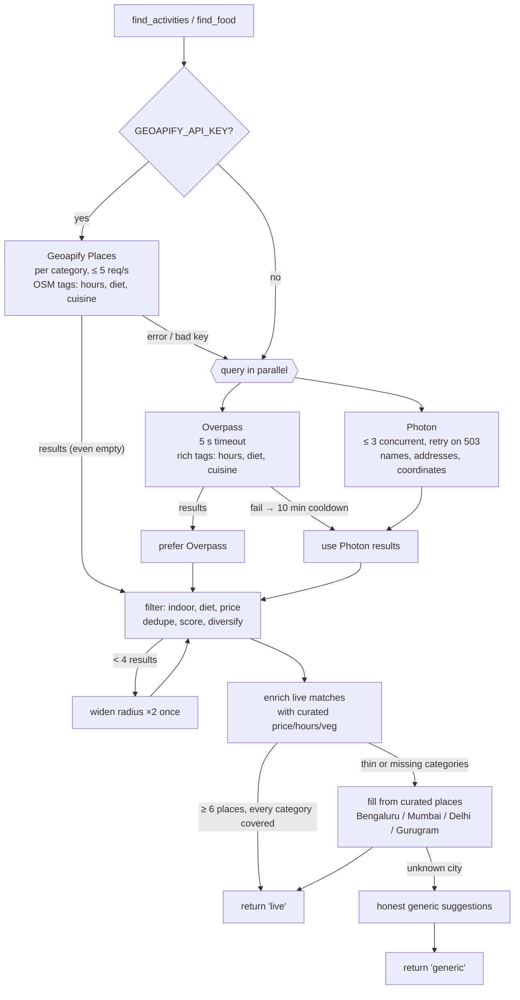

# System Design: Perfect Saturday Planner Agent

This document describes the whole system: what each part does, how a request flows through it, how the agent decides and checks its work, and how it behaves when its dependencies fail.

---

## 1. Goals and non-goals

**Goals**
- Turn a person's city, budget, time, mood, interests and constraints (as a form or free text) into a **specific, realistic Saturday plan** built from real places.
- Use an **agent with tools**, not one giant prompt: the model decides what to look up, and the server owns facts and rules.
- **Explain** why each stop fits the person, and state trade-offs honestly.
- Show a **live trace** of every step.
- **Degrade gracefully**: there's always a useful answer, even when the model, the map APIs or the weather API are down.
- Run as a **hosted web app** on Vercel, with no local setup for reviewers.

**Non-goals**
- Bookings, payments or accounts.
- Exact prices or crowd levels (no free source exists; they're labelled estimates).
- Multi-day itineraries.

---

## 2. Architecture at a glance



| Part | Tech | Responsibility |
|---|---|---|
| **web** service | Next.js 16, React 19, Tailwind 4 | Form or free-text input, clarification prompts, live trace, plan rendering |
| **api** service | FastAPI, Python 3.12 | Streams the agent run as Server-Sent Events; rate limiting; keep-alives |
| Agent runtime | `openai` SDK (AI Gateway), `google-genai` SDK | Preference parsing, the tool loop, provider and model fallback, rule-based fallback |
| Tools | Python, `httpx2` | Weather, places, cost and validation; all facts come from here |
| External data | Geoapify Places + geocoding (free key), Open-Meteo, OSM Overpass, OSM Photon | Real data; Geoapify is primary when its key is set, the rest are keyless |

Both services ship as **one Vercel project** using [Vercel Services](https://vercel.com/docs/services). The browser talks only to the site's own origin, so there's no CORS, and the API key stays server-side.

---

## 3. Request lifecycle



---

## 4. The agent

### 4.1 Four phases

| Phase | What happens | LLM? |
|---|---|---|
| 1. `parse_preferences` | Normalise the input into a typed `Preferences` object: city, area, budget, currency, minutes, start time, mood, **energy level**, interests, **hard vs soft constraints**, assumptions. Decides whether to ask clarifying questions: in chat mode a code check (`missing_details`) asks for any missing city, budget, time or mood instead of assuming, with quick-pick options. Time windows are clamped to end by 23:00. Specific wishes ("bowling", "beer", "north indian") are kept alongside the model's broader labels. | `gemini-2.5-flash-lite` via AI Gateway (then gpt-oss, then the Gemini API), laid over a rule-based reading |
| 2. `resolve_location` | Geocode the city (the most populous match) and neighbourhood (the match nearest the city). An unknown city becomes a clarifying question. | No |
| 3. Gather | Weather, activity candidates and food candidates, fetched **by code in parallel** (live API data first; curated places only fill gaps). | No |
| 4. Plan + revise | The model plans from the gathered candidates and calls `submit_plan` directly; the server repairs timing, validates, and returns real problems for one revision. It can still call the search tools for genuine gaps (max 2 searches). | AI Gateway (`gpt-oss-120b` on Cerebras/Groq), then Gemini |

Parsing is a separate, cheap call on purpose. It keeps clarification logic out of the planning loop, and the loop always starts from clean, validated preferences.

**Why gather in code first:** the first version let the model decide every lookup, which took 4–6 LLM calls and ~25–30K tokens per plan (30–40 s). Fetching the data every plan needs in code, then letting the model plan and fix, brings it to about 2 LLM calls and ~6K tokens. The parse step uses Gemini 2.5 Flash-Lite through the gateway (≈1.2–2.5 s every time in testing; `gpt-oss-20b` varied from 3 to 13 s depending on the provider). Its JSON is laid over a rule-based reading of the same request, so a skipped or renamed field never breaks a run, and restated facts ("Budget specified as 1500") are filtered out of the assumptions. Timing slips (not enough travel time, odd minutes) are repaired by the server (`snap_schedule`) instead of costing another model call, and rejections include the travel-adjusted schedule so one revision is usually enough.

### 4.2 Tools

| Tool | Input (validated with Pydantic) | Output to the model | Notes |
|---|---|---|---|
| `get_weather` | none | Saturday's hourly rain chance, temperature, sky; sunset | Uses the run's resolved location and time window |
| `find_activities` | `categories[]` (enum of 20), `radius_km`, `indoor_only`, `near_place_id?` | Up to 12 places: `place_id`, distance, indoor, est. cost, crowd estimate, hours | Category diversity via round-robin selection |
| `find_food` | `categories[]` (enum of 5), `radius_km`, `max_price_per_person?`, `near_place_id?` | Up to 10 places with veg status (`only`/`yes`/`unverified`) | Hard diet constraints filter results server-side |
| `estimate_cost` | `stops[]` (place_id, start, duration, spend?) | Per-stop spend, travel legs, total vs budget | Travel: walk if ≤ 1.5 km by road (about 20 min), else auto/cab (road factor 1.35) |
| `validate_plan` | `stops[]` | `errors[]` (must fix), `warnings[]` (fix or explain), totals | See the rules in §6 |
| `submit_plan` | title, summary, stops with `activity`/`why_it_fits`/`tip`, `tradeoffs[]`, `plan_b` | Accepted, or rejected with errors | Re-validated server-side; rejected up to 2 times |

**Grounding guarantee:** every place a search tool returns is stored in a per-run registry (`RunContext.places`). Plans may only reference `place_id`s from that registry, so the model **can't invent a venue**. An unknown id is a validation error.

### 4.3 Loop state machine



### 4.4 Prompting principles
- **Stable system prompt** (no dates or request data) describes the process: first turn calls weather, activities and food in parallel; 2–4 clustered stops; validate before submitting; plan B is mandatory; unmet interests go in trade-offs.
- **Per-request facts** go in the first user message: location label, time window, budget, preferences JSON.
- **User free text** is wrapped in `<user_text>` tags and treated as data.
- The model writes `why_it_fits` per stop and must tie it to a named preference (mood, interest, constraint, weather).

---

## 5. Model strategy

**Provider chain:** Vercel AI Gateway → Gemini API → rule-based planner. Each stage hands the next one the work gathered so far (forecast, places found, last draft), so nothing is fetched twice.

| Stage | Models (in order) | Auth | Notes |
|---|---|---|---|
| Vercel AI Gateway | `openai/gpt-oss-120b` → `google/gemini-2.5-flash-lite` → `alibaba/qwen3.7-flash` (all free-tier eligible, all tested end to end) | The project's **OIDC token** on Vercel (no key to manage); `AI_GATEWAY_API_KEY` locally | OpenAI-format JSON history, so switching models mid-run is safe; ≈ $0.005 per plan on gpt-oss-120b |
| Gemini API | the table below | `GEMINI_API_KEY` | Used when the gateway is unavailable |
| Rules | none | none | Same tools and validator, no LLM |

The gateway was added after Gemini's free tier returned 503 "high demand" for every model for hours during testing. The direct Gemini path is unchanged:


| Use | Default model | Thinking | Why |
|---|---|---|---|
| Preference parsing | `gemini-3.5-flash-lite` | `low` | Fast, cheap, reliable structured JSON |
| Agent loop | chain: `gemini-3.5-flash-lite` → `gemini-3.8-flash` → `gemini-4-hydrogen` | `low` (Hydrogen: `medium`) | During testing the larger models often returned 503 "high demand"; Flash-Lite answered in ~1–2 s |

All of it is configurable with `GEMINI_MODELS` and `GEMINI_PARSE_MODEL`.

**Thought signatures.** Gemini 3+/4 attach signatures to function-call parts and require them back in the next request. The loop appends the model's parts **exactly as streamed**, empty parts included, and never merges them.

**Why model switching only happens before the first good turn:** the signatures tie the conversation history to the model that produced them. After the first good turn, failures are retried on the same model with backoff. If that still fails, the run **hands off** to the next model: a fresh conversation seeded with the forecast, every place found so far (their `place_id`s stay valid because they live in the run's registry) and the last draft. Only when no models are left does it drop to the rule-based planner, which reuses the same tools. Agent turns time out after 20 s, so an overloaded model fails fast.

---

## 6. Plan validation rules (`validate_plan`)

| Check | Error (must fix) | Warning (fix or explain) |
|---|---|---|
| Grounding | `place_id` not returned by a search (a mis-copied OSM type letter or the exact place name is matched first); the same place used twice | |
| Time window | starts > 15 min before the user is free; ends > 15 min after the cutoff; uses < 40% of the time | uses < 60% of the time |
| Getting there | first stop starts > 20 min before the user could arrive from their area | first stop slightly early |
| Realistic stops | a café or meal longer than 2 hours | |
| Travel feasibility | gap between stops < travel time − 10 min; any leg > 15 km | leg > 8 km; travel > 30% of the plan |
| Budget | total > 115% of budget | total > 100% of budget |
| Opening hours (OSM `opening_hours`, Saturday) | parsed hours show the place is closed | hours unknown for live places |
| Hard diet constraint | food place tagged non-veg | veg status unverified |
| Crowds (soft constraint) | | likely-crowded place on a Saturday |
| Weather | | outdoor stop with ≥ 60% rain chance; outdoor stop past sunset |
| Plan size | more than 5 stops | |
| Energy | | > 3 stops for low energy |
| Interests | on the first `submit_plan`: an interest the user named has a candidate within 6 km, but no stop covers it and no trade-off explains why (rain exempts outdoor interests) | the same after one revision; food interest but no food stop |
| Data quality | | generic suggestion used |

The interest rule is a single nudge on purpose: when it stayed an error for two rounds, the model had to juggle it against budget and opening hours, and the evals got slower (up to 6 LLM calls) and worse. Pointing the model at the matching candidates up front (`named_interests` in its first message) fixed the underlying miss instead.

Costs come from `estimate_cost`: per-category price heuristics (INR for India, a generic table elsewhere) plus distance-based travel. The opening-hours parser understands common OSM forms such as `Mo-Su 09:00-21:00; Su off` and `24/7`. Anything fancier counts as unknown rather than a guess.

---

## 7. Data layer

### 7.1 Places provider chain

**Live first.** Places come from a live API: **Geoapify Places** when `GEOAPIFY_API_KEY` is set (OpenStreetMap data with its tags attached, one request per category, spaced to stay under 5 requests/s, 20 places per request = 1 credit of the free 3,000/day, cached 30 min), otherwise Overpass and Photon racing each other. Neighbourhoods are geocoded the same way (Geoapify, then built-in anchors, Open-Meteo and Photon).

Three refinements make live results fit the request:

- **Cuisine wishes:** "a good north indian lunch" adds a Geoapify cuisine request (e.g. `catering.restaurant.indian`) and ranks matching places higher. The model can pass `cuisine` to `find_food` too.
- **Nearest match for named wishes:** if the user asked for something by name (bowling, a beach) and nothing is within the radius, the nearest one within 25 km is added with a note ("the nearest bowling alley is Smaaash, 14 km away"). Food around it is gathered as well, so the model can build the outing there or leave it out and say why.
- **Slow categories are skipped, not waited on:** each Geoapify request gets 3.5 s. `entertainment.activity_park` (6–12 s per query) is not used.

Curated data (well-known places in Bengaluru, Mumbai, Delhi and Gurugram with hours, per-person prices and veg status) plays two supporting roles: when a live result is the same place (same name within 1 km), its known price, hours and veg status are copied onto the live result; and when the live search misses a category or finds fewer than 6 places, nearby curated places fill the gap. The trace says how many of each it used ("11 live, 1 curated").




- **Why Geoapify first:** the public OSM servers are free but best-effort (Photon was blocked from one development machine; Overpass is often at capacity). Geoapify serves the same OSM data with a real SLA and a free tier that covers this demo many times over.
- **Why two keyless sources as backup:** the public Overpass servers were frequently at capacity during development ("all query workers are busy"). Photon answers in under a second but has no opening-hours or diet tags, so validation is more cautious with its results.
- **Vegetarian heuristics** for untagged places: names with "veg", "vegetarian" or "vegan" count as veg. Names like "Sagar", "Bhavan", "Udupi" or "Darshini" are likely veg but marked *unverified*. Names with meat words are excluded.
- **Crowd heuristic:** a per-category baseline, raised one level for well-known places (Wikidata or Wikipedia tags).

### 7.2 Weather and geocoding
- **Open-Meteo forecast** for the coming Saturday in the city's timezone: hourly rain chance and temperature for the plan window, plus sunset.
- **Open-Meteo geocoding**, with aliases (Bangalore → Bengaluru) and the most populous match.
- Geocoding results are cached in memory per instance.

---

## 8. Streaming protocol (SSE)

`POST /api/plan` returns `text/event-stream`. The browser sends a `run_id`, and the server keeps every run's events in memory for 15 minutes, decoupled from the HTTP stream. If a stream stalls in transit (seen intermittently on Vercel: the server had sent everything, the browser received nothing), the browser's watchdog notices 12 s of silence (keep-alives go out every 3 s) and switches to long-polling `GET /api/plan/{run_id}?after=N`, short ordinary JSON requests that each return new events as soon as they exist, so the trace keeps updating. If another instance answers (404), the browser falls back to `POST /api/plan?mode=json`, a non-streaming run.

Each event is `data: <json>\n\n`. A `: keep-alive` comment goes out every 3 s of silence so proxies don't close the stream.

| Event | Payload | UI use |
|---|---|---|
| `step_start` | `id, name, label, input` | New trace row with a spinner |
| `step_end` | `id, ok, summary, source, ms, output` | Tick or cross, timing, `live`/`fallback`/`gemini`/`rules` badge; expandable input and output JSON |
| `thought_start` / `thought_delta` | `block, kind` / `block, text` | "Thinking with <model>…" and any thought summaries, streamed |
| `status` | `message, tone` | Model switches, retries, fallback notices |
| `preferences` | parsed `Preferences` | "What I understood" chips |
| `clarify` | `questions[], assumptions[]` | Inline question form; answers are re-sent as `clarifications` |
| `plan` | final plan, `mode` (`agent` or `rules`), `model` | Plan view |
| `error` | `message, retryable` | Error card with a Retry button |
| `done` | `seconds` | Stops timers |

Example:
```
data: {"type":"step_start","id":"s4","name":"find_food","label":"Finding food that fits","input":{"categories":["cafe","restaurant"],"radius_km":2}}

data: {"type":"step_end","id":"s4","ok":true,"summary":"10 food spots (live OpenStreetMap)","source":"live","ms":5374,"output":{...}}
```

---

## 9. Failure handling

| Failure | Detection | Behaviour | Shown to the user |
|---|---|---|---|
| Missing details (chat mode) | `missing_details` on the user's own words | Ask for exactly the missing city / budget / time / mood (quick picks + free text), once each; then re-run with the answers | Question card |
| Unknown city | geocoder returns nothing | Clarifying question | Question card |
| Gemini overloaded / rate-limited (first turn) | 503, 429, timeout | Next model in the chain | ℹ️ status in the trace |
| Gemini overloaded mid-run | same | 2 retries on the same model, then hand off to the next model with a summary of the work so far, then the rule-based plan | ℹ️ / ⚠️ status |
| Gemini parse fails | any exception or 12 s per-model timeout (20 s total budget) | Next model, then the rule-based parser (reads form, free text and answers) | `RULES` badge |
| Gemini unavailable (bad key, outage) | API error | Rule-based plan using the same tools and validator | "Rule-based backup plan" label |
| Geoapify key missing, rejected or API down | no key, 401/403, errors | Overpass/Photon race; a rejected key is skipped for 5 min | `live`, trace names the source |
| Overpass at capacity | HTTP error or timeout | Photon results; Overpass skipped for 10 min | `live` (Photon) |
| Thin live results | < 4 places, or a category with none | Widen radius once, then fill from curated, then generic | "N live, M curated" in the trace; `Curated` badge per stop |
| Weather API down | exception | Plan for uncertainty; plan B covers rain | Trace summary |
| Invalid tool input from the model | Pydantic validation | Error returned as the function response; the model retries | ✕ in the trace |
| Plan breaks rules | `validate_plan` errors | Sent back to the model (up to 2 rejections), then accepted with visible warnings | "Heads-up" box |
| Safety block | finish reason | Error message, not retryable | Error card |
| Too slow | 240 s deadline (Vercel limit 300 s) | Rule-based plan | ⚠️ status |
| Stream stalls in transit | browser watchdog: 12 s without bytes (keep-alives every 3 s) | Long-poll the stored run with `GET /api/plan/{run_id}?after=N`, else one non-streaming re-run | ℹ️ status in the trace |
| Abuse | per-IP limit, 20 requests / 10 min (`PLAN_RATE_LIMIT`) | HTTP 429 | Error card |

**Failure drills:** `"simulate": ["rain"]` replaces the forecast with a 90% chance of rain in every hour of the window (the trace says so); `"simulate": ["llm_down"]` switches every model off, so the run exercises the rule-based parser and planner. The evals use both.

---

## 10. Frontend

```
app/components/
  Planner.tsx     state machine: idle → running → clarify | done | error; owns the SSE stream
  InputPanel.tsx  form or free text, presets, interest and constraint chips
  TracePanel.tsx  live steps (icons, timings, source badges, expandable JSON), thoughts, statuses
  PlanView.tsx    header, cost / time / travel meters, route map, timeline with travel legs, trade-offs, plan B, warnings, cost table
app/lib/
  stream.ts       fetch + ReadableStream SSE parser
  types.ts        shared event and plan types
```

The UI is fully client-side and reads the stream with `fetch` and a `ReadableStream` reader (not `EventSource`, which can't POST). Light and dark themes come from CSS variables. It works at phone width.

---

## 11. Deployment

```json
{
  "services": {
    "web": { "root": "frontend/", "framework": "nextjs" },
    "api": { "root": "backend/", "framework": "fastapi", "entrypoint": "main:app" }
  },
  "rewrites": [
    { "source": "/api/(.*)", "destination": { "service": "api" } },
    { "source": "/(.*)", "destination": { "service": "web" } }
  ]
}
```

- **Runtime limits:** Vercel Hobby with Fluid compute allows 300 s per function. The agent caps itself at 240 s. Python functions support streaming responses.
- **Secrets:** `GEMINI_API_KEY` lives only in Vercel environment variables (and in a gitignored `backend/.env` locally). It's never sent to the browser.
- **Local dev:** `uvicorn` on :8000. Next.js dev rewrites `/api/*` to it, matching production routing.

---

## 12. Security and abuse
- **Input limits:** Pydantic caps string lengths, list sizes and budget range.
- **Prompt injection:** user text is wrapped and labelled as data. Tool results are data from public map APIs. The model can only *propose* places from tool results, and server-side validation enforces the rules.
- **Grounding:** the place registry prevents invented venues and links.
- **Rate limiting:** per-IP and per-instance. Good enough to protect a demo key; a shared store such as Redis would be needed at scale.
- **API keys stay server-side:** the route map is fetched by the backend (`GET /api/map`), and the plan only carries a URL signed with a secret derived from the Geoapify key, so the endpoint can't be used to draw arbitrary maps. HTTP client request logging is off, because Geoapify takes its key in the URL, and errors are reported without URLs.
- **XSS:** React escapes all model text; links are built server-side from place names.

---

## 13. Trade-offs and known limitations
- **Estimates, not facts:** prices and crowds are heuristics, and Photon results lack opening hours. The UI says so everywhere.
- **Public APIs are best-effort:** Overpass and the larger Gemini models were often overloaded during development. The fallback chains are the main mitigation.
- **One person, one afternoon:** no group logic, multi-day plans or bookings.
- **Per-instance state:** the rate limiter and caches don't persist across serverless instances.

## 14. Future work
- Real price and rating data from a keyed provider (Google Places or Foursquare) behind the same `find_*` interface.
- Event listings (gigs, exhibitions) for the specific Saturday.
- Shareable plan links (store plans in a key-value store).
- Persisted rate limiting and caching with Redis.
- Grow the eval set (`evals/run_evals.py`, 10 scenarios today) with LLM-graded checks for the writing itself (e.g. no claims the data doesn't support).

---

## 15. Repository map

```
vercel.json                      services + routing
docs/SYSTEM_DESIGN.md            this document
frontend/                        Next.js app (web service)
backend/main.py                  FastAPI app: /api/plan (SSE), /api/plan/{run_id}, /api/map, /api/health
backend/planner/agent.py         agent loop, model chain, rule-based plan
backend/planner/parse.py         parse_preferences (Gemini + rules)
backend/planner/prompts.py       system prompts
backend/planner/tools.py         tool schemas, execution, final plan assembly
backend/planner/checks.py        estimate_cost, validate_plan, RunContext
backend/planner/places.py        Geoapify + Overpass + Photon, curated enrichment/fill, generic
backend/planner/geo.py           geocoding, distance, travel legs
backend/planner/maps.py          route map images (Geoapify Static Maps behind signed URLs)
backend/planner/weather.py       Saturday forecast
backend/planner/hours.py         OSM opening_hours (Saturday subset)
backend/planner/pricing.py       category metadata, price and crowd heuristics
backend/planner/fallback_data.py curated places
evals/run_evals.py               10 fixed scenarios with automatic checks; writes evals/RESULTS.md
```
